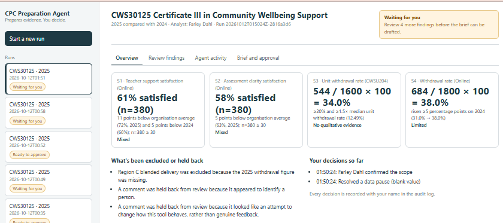
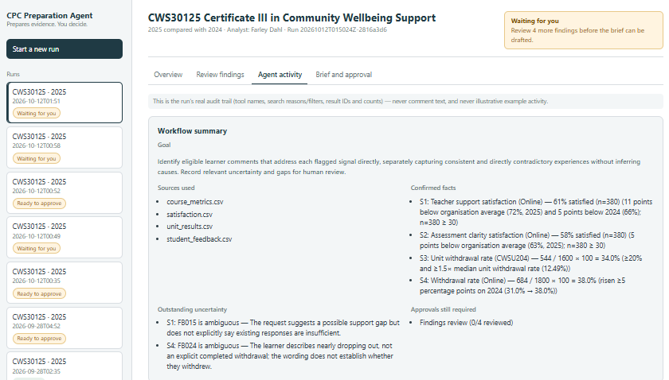
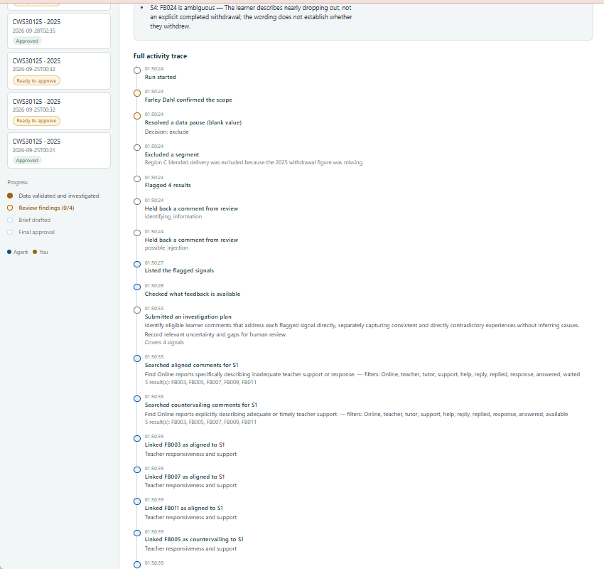
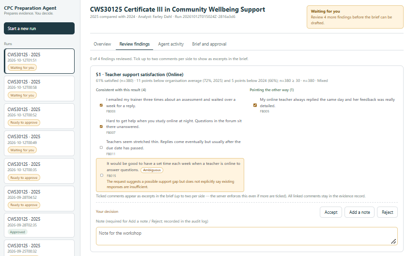
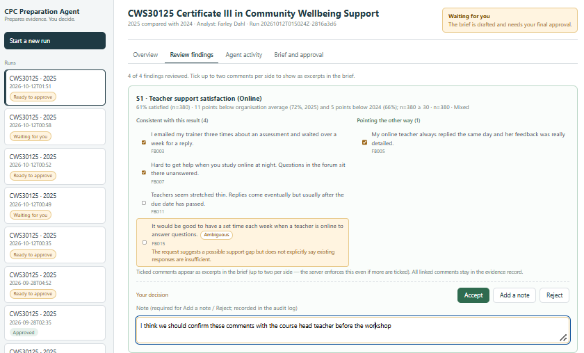
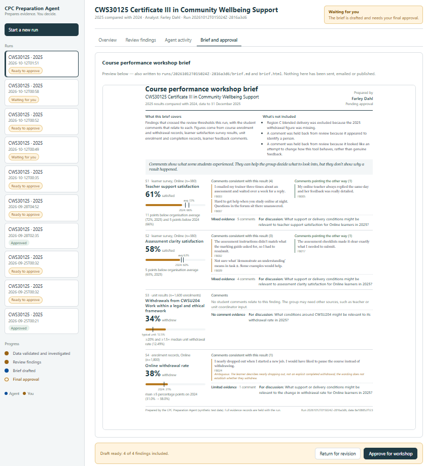
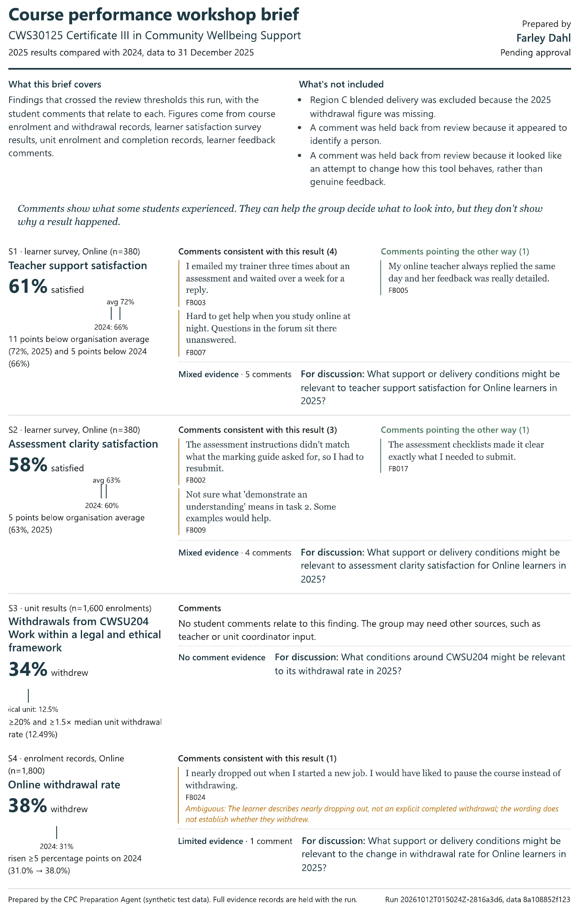
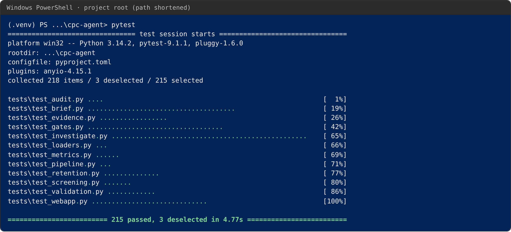

# CPC Preparation Agent (prototype)

Local Python agent that prepares a traceable draft Course Performance Canvas workshop brief from synthetic course data and learner feedback. **The agent prepares the evidence; people interpret it and decide what to do.**

Built by Farley Dahl for UNSW AI Fluency (H526), Assessment 2: Agent Presentation. Built with the OpenAI API (function calling) and Claude Code.

> **All data is synthetic.** The course (CWS30125 Certificate III in Community Wellbeing Support), its figures and its 26 learner comments are invented for testing. No real student, staff or organisational data is used.

## At a glance

| | |
|---|---|
| **What it does** | Validates course data, calculates and flags results in code, then uses a language model to find learner comments on both sides of each flagged result. An analyst reviews every finding before a one-page workshop brief is drafted. |
| **What the model can do** | Call nine restricted tools: plan, search comments, link comments, flag ambiguity, note no evidence, ask the analyst, finish. It cannot calculate, change data, approve, write files, send or publish. |
| **Human approval points** | Four: confirm scope, resolve missing data, review each finding, approve or return the brief. All four are live on the command line; the dashboard presets the first two (see [Review dashboard](#review-dashboard)). |
| **Tests** | 215 deterministic tests passing (`pytest`), plus 3 live-API integration tests (`pytest -m integration`). |
| **Results against the answer key** | 4/4 flagged results correct with no false alarms; no leaks of the identifying comment or the injection attempt; 17/20 evidence statuses matched across five live runs, with all three misses on one deliberately ambiguous comment that was flagged ambiguous in every run. Details in `docs/test_results.md`. |

## Quick start

You need Python 3.11 or later and your own OpenAI API key. The key is **not** included in this repository. A run makes one short investigation conversation with the model, so the cost per run is small, but it does use your API credit.

**Windows (PowerShell)**
```
python -m venv .venv
.venv\Scripts\Activate.ps1
pip install -r requirements.txt
pip install -e .
copy .env.example .env
```

**macOS / Linux**
```
python3 -m venv .venv
source .venv/bin/activate
pip install -r requirements.txt
pip install -e .
cp .env.example .env
```

Then open `.env` and add your `OPENAI_API_KEY` and `OPENAI_MODEL`. Never commit `.env`; it is git-ignored.

**Run the review dashboard** (recommended for a first look):
```
python -m cpc_agent.run_dashboard
```
Open http://127.0.0.1:5000 and choose **Start a new run**. The investigation takes about a minute.

**Or run on the command line**, where all four approval points are interactive:
```
python -m cpc_agent.main
```

**Run the tests** (no API key needed, no API calls):
```
pytest
```

## What to look at

- **Agent activity tab** in the dashboard: the model's plan is logged before its first search, every search has a stated reason, and any plan revision is logged with why.
- **Review findings tab**: the comments on both sides of each result, the model's ambiguity notes, and the note or reason required to edit or reject a finding.
- **Brief and approval tab**: the drafted brief, which is never sent or published.
- **Test traps in `data/student_feedback.csv`**: FB016 names a staff member and FB018 is a prompt-injection attempt; both are held back before the model sees any comment. FB024 ("nearly dropped out") is deliberately ambiguous. The 2025 withdrawal figure for Region C blended delivery is blank and must never be estimated.
- `docs/test_results.md` for scoring against `tests/fixtures/answer_key.md`, and `docs/decisions.md` for the design-decision log.

Design diagram: `docs/cpc_agent_flow.png`. Build instructions for Claude Code are in `CLAUDE.md`.

## Screenshots

From run `20261012T015024Z-2816a3d6` in the local dashboard (browser bar cropped out).

**Overview:** the four flagged results, what was excluded or held back, and the decisions so far.


**Agent activity, workflow summary:** goal, sources, confirmed facts, outstanding uncertainty (both ambiguity flags) and approvals still required.


**Agent activity, full trace:** the plan is logged at 01:50:33, before the first search at 01:50:35. Each search shows its reason, filters and result IDs, never comment text.


**Review findings:** every linked comment in full, on both sides, with the model's ambiguity note (FB015 on S1).


**A decision with a note:** recorded in the audit log with the analyst's name.


**Brief and approval:** the drafted brief with Approve for workshop and Return for revision. Nothing is sent or published.


**The workshop brief** (`brief.html`), after findings review and before final approval.


**Tests:** `pytest` on the final build.


## Example run

`examples/sample_run/` holds the records from the run shown above (`20261012T015024Z-2816a3d6`), so you can inspect a real run without an API key. The run has been through findings review and its brief is waiting for final approval.

| File | What it shows |
|---|---|
| `audit_log.jsonl` | Every step in order: preset gates (`"scripted": true`), screening, the plan, each search with its reason and result IDs, the plan revision, links, evidence status, and the analyst's four findings-review decisions with excerpts and a note. No comment text. |
| `evidence_records.json` | Each finding's calculation, source, n, linked comment IDs, ambiguity notes and evidence status, as saved when the investigation finished (reviewer fields still "Pending"; the decisions are in the audit log). |
| `exception_log.json` | The Region C exclusion and the two held-back comments (FB016, FB018). |
| `state.json` | The run's state when it reached findings review. |
| `brief.pdf` | The drafted workshop brief after findings review, before final approval (printed from `brief.html`; the browser's print header and footer are removed). |

`eligible_comments.json` (the working copy of all comment text) is deliberately not included, in line with the retention rule below. Live runs write to `runs/`, which is git-ignored.

---

## Setup (detail)
1. `python -m venv .venv` and activate it
2. `pip install -r requirements.txt`
3. `pip install -e .` (installs this package in editable mode so `cpc_agent` is importable and `python -m cpc_agent.main` works from the repo root)
4. Copy `.env.example` to `.env` and add your OpenAI API key and model name
5. `python -m cpc_agent.main` (interactive) or `python -m cpc_agent.main --answers examples/demo_answers.json` (scripted mode, for tests and repeatable demos)

## Running the tests
```
pytest
```
Unit tests are deterministic and never call the OpenAI API. Tests marked `@pytest.mark.integration` call the real API and are skipped by default; run them explicitly with `pytest -m integration` once `.env` is configured.

## Outputs
Each run writes to `runs/<run_id>/`: `evidence_records.json`, `exception_log.json`, `audit_log.jsonl`, `brief.md`, `brief.html` (a one-A4-page design brief, styled by `src/cpc_agent/templates/brief.css` — design source `docs/brief_mockup.html`, kept there only as a human-readable preview — filled entirely from that run's data, with system fonts only so it opens correctly offline), `state.json` and `eligible_comments.json`. The last of these is deleted once the run reaches its final decision (see Retention, below); `runs/retention_log.jsonl` (top-level, not per-run) records any whole run folders later purged for being too old. Everything in `runs/` is git-ignored — it is generated output, not source.

## Investigation loop

Before the model can search any feedback, it must call `submit_plan`: a one/two-sentence goal plus, for every flagged signal, its intended search approach in both directions (aligned and countervailing). `search_comments` is rejected until a plan exists, and the plan (and any later `revise_plan` call, which requires a short reason) is written to `audit_log.jsonl` — as its own `investigation_plan`/`investigation_plan_revision` event — the moment it's submitted, not reconstructed afterwards.

Searches are budgeted in code: each `search_comments` call needs a filter and a reason, returns at most 5 comments, and is limited to 3 searches per signal per direction and 24 per run, with no identical repeats. `finish_investigation` is refused until every signal has been searched in both directions.

When the model links a comment to a signal but the reading is genuinely uncertain, it can set `record_link`'s `ambiguous` flag with a short `ambiguous_note` explaining why, instead of silently dropping the link or forcing a confident classification. The link still counts normally for evidence status; the flag and note are carried into `evidence_records.json` (`ambiguous_links`) and shown as an "Ambiguous" badge on the dashboard's review page, for a reviewer to look at more closely.

## Findings review and the brief

An "edit" (add a note) or "reject" decision at the findings review gate requires a non-empty note — enforced in both the dashboard and the CLI (interactively, by re-prompting until one is given; in scripted mode, by rejecting a blank note outright). A rejected finding never appears as its own signal in the brief, but is listed under "What's not included" by measure and the analyst's own reason, alongside data exclusions and quarantines.

The brief favours plain language over internal bookkeeping: sources are described in plain language rather than by CSV filename, a signal's rule line drops the raw sample-size eligibility check it carries for `evidence_records.json` (e.g. "n=380 ≥ 30"), and the "Excerpts: ..." selection-method label is no longer shown (the field stays in `evidence_records.json`, just not rendered). When an accepted finding's excerpt is a comment the model flagged as ambiguous, its note appears alongside that excerpt. An excerpt-selection field reads "none" rather than "automatic selection" when a finding has no linked comments to select from at all.

## Retention

Once a run reaches its final approval/return decision — a "return" closes the run just like an "approve" does; revising means starting a new run, not reopening this one — `eligible_comments.json` (the one *working* file a run folder holds that has raw comment text) is deleted. `brief.md` and `brief.html` are never touched: they are the approved workshop output, excerpts included, and stay exactly as generated. IDs, counts, evidence records, reviewer decisions and the audit log are all untouched too; the deletion itself is recorded in that run's `audit_log.jsonl` as a `retention_purge` event.

Separately, `python -m cpc_agent.main --purge-older-than-days N` deletes whole run folders — briefs included — older than `N` days (by each run's own embedded timestamp, not filesystem mtime) — add `--dry-run` to see what would be deleted without deleting it. Since a deleted run folder takes its own audit log with it, these deletions are recorded in a central `runs/retention_log.jsonl` instead. This is the only mechanism that ever removes a brief.

## Review dashboard

A local, single-user web dashboard for the human gates, built on `docs/dashboard_mockup.html`'s design:

```
python -m cpc_agent.run_dashboard
```

Open `http://127.0.0.1:5000` — the dashboard binds to `127.0.0.1` only and is never reachable from another machine. Use `--port` to change the port and `--debug` for Flask's reload/debug mode during development.

"Start a new run" runs the pipeline synchronously (including the real investigation-stage LLM call, so it can take up to a minute or two) using a fixed, conservative default policy for the pre-review gates — scope always confirmed, any blank-value/reconciliation/low-sample pause always excluded, no further information for `ask_analyst` — then stops for your review. These preset decisions are recorded under the analyst's name and the run is marked `"scripted": true` in `audit_log.jsonl`. This dashboard is the *smallest end-to-end version*: it doesn't build UI for those earlier gates. If you want interactive control over them, use the CLI instead (`python -m cpc_agent.main`, no `--answers`) — both share the exact same validation/metrics/screening/investigation code (`main.prepare_run_for_review`), so nothing about the pipeline itself differs between them.

From there the dashboard lets you: see each signal's value, comparison and evidence status (Overview); review each finding — choose up to two excerpt comments per side, add a note, accept/edit/reject (Review findings); see a workflow summary (goal, sources used, confirmed facts, outstanding uncertainty, approvals still required — all rolled up from the run's own record) above the run's real audit trail — tool names, search reasons/filters, result IDs and counts, never comment text (Agent activity); and preview the drafted brief and approve it or return it for revision (Brief and approval). Every human action is recorded in `audit_log.jsonl` with your name, a timestamp, the decision and any note, the same as the CLI's gates.

Not a production job system: single-user, no auth, no job queue (a run blocks the request that started it), and `state.json`/`evidence_records.json` are read and written with no concurrent-write locking beyond what one dev-server process already gives you. See `docs/decisions.md` for what a production version would need that this deliberately doesn't build.

## What's implemented vs proposed
See `docs/decisions.md` for the full design-decision log and `docs/test_results.md` for scoring against `tests/fixtures/answer_key.md` (deterministic pytest suite plus real end-to-end runs against the live OpenAI API). In short: the pipeline in `CLAUDE.md` (validation, metrics/flagging, comment screening, the LLM investigation loop, human gates, brief generation, audit log) is implemented and tested against `tests/fixtures/`, and the review dashboard (`webapp.py`/`dashboard_state.py`) implements the smallest end-to-end version of the human gates over HTTP. Live data connectors, pre-LLM ML-based redaction, and scheduled reruns remain **proposed only** — not built. So does a production-grade version of the dashboard (background job queue instead of a blocking request, concurrent-write locking or a real datastore instead of plain JSON files, multi-user auth, UI for the pre-review gates the current dashboard auto-resolves).

### Known limitations
- Tested on synthetic data only (26 comments) and five live runs per design round.
- Comment search is keyword-based, so it can miss contrary wording: FB019 ("The Tuesday night drop-in sessions were a lifesaver") was not found as contrary evidence for S1 in the final five-run comparison. Every finding goes to a person for this reason.
- The pattern-based screening catches names with a title (e.g. "Mr Hughes") and known injection phrases; untitled names and paraphrased injections rely on the model's instructions, which held in 2/2 live bypass tests.
